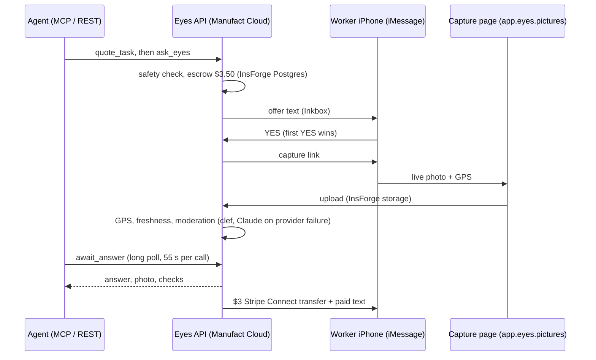

<h1 align="center">👀 Eyes</h1>

<div align="center">

**Your agent asks a question about a real place. A nearby person takes a live photo and answers it.**

[](https://github.com/ayaangazali/eyes/actions/workflows/ci.yml)
[](https://eyes.pictures)
[](https://mcp.eyes.pictures/mcp)

[Site](https://eyes.pictures) · [Worker app](https://app.eyes.pictures) · [Connect](docs/CONNECT.md) · [Deploy](docs/DEPLOY.md) · [Status](STATUS.md)


*The kind of photo Eyes returns: is the cafe open right now? The sign says yes.*

</div>

Agents can read the internet but cannot see the street. Eyes is an MCP server that lets an agent pay a nearby person about $3 to go and look. Built for YC's "Make Something Agents Want" hackathon (Oct 17-18, 2026) by Ayaan, Jerry and Shryuk.

## Features

- **[MCP tools](docs/features/mcp-tools.md):** 13 model-visible tools to quote, ask, wait, accept answers, review classifier refusals and manage tasks and money; plus app-only `confirm_ask`. REST and non-UI automation retain direct dispatch.
- **[ChatGPT and Claude apps](docs/features/chatgpt-claude-apps.md):** configured at the dedicated MCP host; OAuth **Continue** hands a new key to the client automatically. Saving it is optional for direct API use.
- **[iMessage dispatch](docs/features/imessage-dispatch.md):** the 3 nearest workers get a text; first YES wins.
- **[Photo checks](docs/features/photo-checks.md):** GPS within 150 m, taken live; moderation rejects confirmed graphic gore or explicit sexual content, not faces alone.
- **[Escrow](docs/features/escrow.md):** bounty plus $0.50 fee held on ask; refunded if no answer.
- **[Safety](docs/features/safety.md):** rules and an AI check refuse private-person, home, vehicle or face-targeted requests; this is separate from photo moderation and is not a blanket ban on faces in photos.
- **[Owner controls](docs/features/owner-controls.md):** spend caps, allowed task types, key rotation.
- **[Worker location](docs/features/worker-location.md):** HERE links, a Shortcut or the iPhone app.
- **[Ops dashboard](docs/features/ops-dashboard.md):** internal.eyes.pictures: tasks, money, reviews, tickets, live map.

## Quick start

1. **Get a key:** no dashboard needed; the test balance is $20.

   ```sh
   curl -X POST https://api.eyes.pictures/v1/signup \
     -H "content-type: application/json" -d '{"name":"my-agent"}'
   ```

2. **Connect:** from Claude Code (ChatGPT, claude.ai, Claude Desktop and Cursor are in [docs/CONNECT.md](docs/CONNECT.md)):

   ```sh
   claude mcp add --transport http eyes https://mcp.eyes.pictures/mcp \
     --header "Authorization: Bearer $EYES_API_KEY"
   ```

3. **Ask:** `claude -p 'Use quote_task to check the line at the Ferry Building, San Francisco'`

Prefer the Manufact CLI? `npx -y mcp-use@2.10.1 client connect eyes https://mcp.eyes.pictures/mcp --protocol legacy -H "Authorization: Bearer $EYES_API_KEY"`. To be a worker, open https://app.eyes.pictures on an iPhone. Until workers have opted in near a place, `ask_eyes` there returns `no_workers_nearby` and charges nothing. https://api.eyes.pictures/status says which parts are live.

ChatGPT and Claude are configured at `https://mcp.eyes.pictures/mcp`; the legacy `https://api.eyes.pictures/mcp` endpoint remains supported. REST signup, uploads and webhooks stay at `https://api.eyes.pictures`. Stripe's provider integration is live, but payments and the $20 signup credit are test-only: no real money moves.

Marketplace version 1.0.3 is a configured draft with preflight complete, not submitted or published. Legal owner attestations and test-mode limits remain. The new ChatGPT card protocol and live API are verified. Follow-up in-chat visual checks on the operator's test accounts were quota-blocked on 2026-10-18, not unavailable for all users; see [STATUS](STATUS.md).

## How it works

In ChatGPT and Claude connectors, the model prepares a read-only draft and the user confirms in the card before Eyes sends or escrows anything. REST, CLI and non-UI MCP can dispatch directly. Every dispatch calls one `EyesService`, and each money move is one plpgsql function, so it runs in one transaction ([ADR-003](intent/decisions/ADR-003-seams-and-ownership.md)). The full flow is in [docs/SPEC.md](docs/SPEC.md).



## Repository layout

- [`apps/mcp/`](apps/mcp/): API server: MCP tools, REST, webhooks, OAuth, `/status`.
- [`apps/edge/`](apps/edge/): Cloudflare Workers: thin API forwarder, cron, uptime monitor—not the MCP/API server host.
- [`apps/web/`](apps/web/): landing site, worker app and the ops dashboard (internal.eyes.pictures).
- [`apps/mobile/`](apps/mobile/): Expo iPhone app that sends background location.
- [`packages/`](packages/): core, engine, db, comms, payments, safety, verify, ui.
- [`cli/`](cli/): the `eyes` CLI and generated agent docs (`llms-full.txt`, OpenAPI).
- [`scripts/`](scripts/): live smoke, owner link, task resolve, migrations, intent check.
- [`evals/`](evals/), [`e2e/`](e2e/): safety evals and the Playwright golden path.
- [`intent/`](intent/): why each file exists ([INDEX](intent/INDEX.md)), ADRs, verdicts.

## More docs

- [Connect from ChatGPT, Claude, Claude Code and Cursor](docs/CONNECT.md)
- [Deploy, live smoke, roll back, alerts](docs/DEPLOY.md)
- [Spec](docs/SPEC.md)
- [Status and live verification](STATUS.md)
- [Plan](docs/PLAN.md)
- [Demo runbook](docs/DEMO.md)
- [Decisions (ADRs)](intent/decisions)
- [Agent docs: llms.txt](docs/public/llms.txt)
- [Report a bug](../../issues/new)

To develop locally you need Node 24, pnpm and Docker: `pnpm install && pnpm verify:fast` runs lint, typecheck, unit, contract, safety fixtures and the intent check without a database (941 tests on 2026-10-17). `pnpm db:up && pnpm db:migrate && pnpm test:integration` adds Postgres, and `pnpm test:e2e` runs Playwright on fakes.

## Built with

Every outside provider and service Eyes uses, and how. "Live" means the deployed server at api.eyes.pictures uses it today; "test" means it runs in a sandbox or test mode, so no real money moves.

| Provider | What Eyes uses it for | Where in the repo | Status |
|---|---|---|---|
| Cloudflare Workers | `eyes-api` forwards `mcp.eyes.pictures`, `api.eyes.pictures` and `internal.eyes.pictures` to Manufact; static Workers serve `eyes.pictures` and `app.eyes.pictures` | [apps/edge/api](apps/edge/api), [apps/web/landing](apps/web/landing), [apps/web/worker](apps/web/worker) | live |
| Cloudflare Containers | Previous API hosting path; not the current production origin | [apps/edge/api/wrangler.jsonc](apps/edge/api/wrangler.jsonc), [docs/DEPLOY.md](docs/DEPLOY.md) §2 | historical |
| Cloudflare Durable Objects | Previous container lifecycle; not the current Manufact application host | [apps/edge/api/worker.js](apps/edge/api/worker.js) | historical |
| Cloudflare KV + Cron | `eyes-monitor` checks `/healthz` every minute, keeps state in KV, texts an alert after two failures | [apps/edge/monitor](apps/edge/monitor) | live |
| Cloudflare DNS | `eyes.pictures` zone and custom domains, including the dedicated MCP host | wrangler configs above | live |
| Cloudflare Workers AI (`clef-omni`) | First-pass task safety classifier; photo moderation rejects only confirmed graphic gore or explicit sexual content | [packages/safety](packages/safety), [packages/verify](packages/verify) | live |
| Cloudflare Browser Integrity rule | Zone security setting on the domains | Cloudflare dashboard only, not in the repo | live (not verifiable from the repo) |
| InsForge | Postgres with RPC functions and RLS for the ledger, claims and expiry; migrations through the migrations endpoint | [packages/db](packages/db), [scripts/insforge-migrate.ts](scripts/insforge-migrate.ts) | live |
| InsForge Storage | Public `photos` bucket for captures; faces alone do not reject or delete photos | [packages/db](packages/db) | live |
| InsForge Sites | Earlier host of the worker web (`*.insforge.site`); replaced by `app.eyes.pictures` | [docs/DEPLOY.md](docs/DEPLOY.md) §3 | earlier |
| Stripe | Provider integration live; Checkout, Connect, transfers and the $20 signup credit remain test-only, with no real money | [packages/payments](packages/payments) | test payments |
| Inkbox | Shared iMessage line, worker dispatch and first-contact email fallback when Primitive refuses delivery | [packages/comms/src/inkbox.ts](packages/comms/src/inkbox.ts) | live |
| Inkbox (limitation) | An iMessage "Share My Location" arrives as a lone U+FFFD, so Eyes replies with a HERE link instead ([ADR-024](intent/decisions/ADR-024-worker-location.md)) | [packages/comms](packages/comms) | live |
| Primitive | Outbound DNS verified and one owner Gmail delivery confirmed; unrestricted sending is still off, first-contact fallback uses Inkbox, and external custom-alias SPF remains unresolved | [packages/comms/src/primitive.ts](packages/comms/src/primitive.ts) | limited live verification |
| Anthropic Claude | Fallback for task-safety or photo provider failures only; used alone without Cloudflare | [packages/safety](packages/safety), [packages/verify](packages/verify) | live |
| OpenStreetMap Nominatim | Geocodes place names in `quote_task` and `ask_eyes` | [apps/mcp/src/geo.ts](apps/mcp/src/geo.ts) | live |
| OpenStreetMap tiles + Leaflet (unpkg) | Maps on the ops dashboard and live map | [apps/web/dashboard](apps/web/dashboard) | live |
| Apple Maps / Google Maps links | Reads coordinates from map links a worker texts in; the capture page links to Google Maps directions | [packages/core/src/util.ts](packages/core/src/util.ts), [apps/web/worker/src/capture.ts](apps/web/worker/src/capture.ts) | live |
| mcp-use | MCP server framework for 13 model-visible tools plus app-only `confirm_ask`, using the shared `ui://eyes/confirmation-card.html` widget | [apps/mcp](apps/mcp) | live |
| Manufact Cloud | Hosts the current MCP/API server at `https://warm-spark-aocdd.run.mcp-use.com`; also provides the CLI connect path | [apps/mcp](apps/mcp), [docs/DEPLOY.md](docs/DEPLOY.md) | live |
| OpenAI Apps SDK / MCP Apps | ChatGPT and Claude connectors configured at the dedicated host; operator test-account visual follow-up was quota-blocked on 2026-10-18, not a general client limitation | [apps/mcp](apps/mcp), [docs/CONNECT.md](docs/CONNECT.md) | API/protocol verified |
| Expo / React Native + Apple | iPhone app with persistent connection across task photos; current distribution is ad hoc, not TestFlight | [apps/mobile](apps/mobile) | ad hoc |
| ClickHouse | Optional copy of the ops event log and Trends charts; Postgres stays the source of truth | [apps/web/dashboard/src/clickhouse.ts](apps/web/dashboard/src/clickhouse.ts) | optional, off on the host |
| Astro, Tailwind, GSAP | Landing and worker web; Better-T-Stack conventions | [apps/web](apps/web) | live |
| Playwright, Vitest, Biome | E2E, unit/contract/safety/integration tests, lint and format | [e2e](e2e), [vitest.config.ts](vitest.config.ts), [biome.json](biome.json) | test |
| GitHub | Code, PRs, issues; Actions run CI, live smoke and the safety LLM eval | [.github/workflows](.github/workflows) | live |

`.env.example` also lists keys for Armature analytics and Blaxel sandboxes; no code uses them yet.
